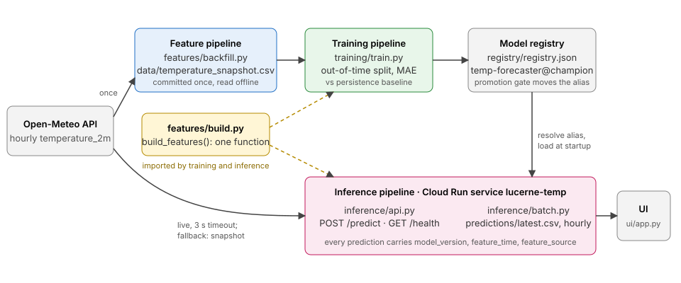

# lucerne-temp

Hourly temperature forecast for Lucerne, 1 to 24 hours ahead. The running example of the
lecture **SW06 Deployment and Serving** (MLOps, HSLU, HS26): a small, complete inference
service that you fork, deploy to Google Cloud Run, update, and roll back. The hands-on part
is in [EXERCISE.md](EXERCISE.md).

> Course example for HSLU MLOps HS26. Not available as a student project topic.
> Use it for ideas, not as a template: your own service should not be a copy of it.

| | |
|---|---|
| Service | `lucerne-temp` (Cloud Run, region `europe-west6`) |
| Registered model | `temp-forecaster` |
| Registry alias | `champion` (v7 in this repo; v8 is the candidate) |
| Live URL | none: you deploy your own in the exercise, and delete it afterwards |

## Architecture



- **Feature pipeline** `src/lucerne_temp/features/`: `backfill.py` fetched 70 days of hourly
  temperature once and committed them as `data/temperature_snapshot.csv` (52 KB).
  `build.py` holds the only feature function, `build_features()`.
- **Training pipeline** `src/lucerne_temp/training/`: trains on the snapshot, so everybody gets
  the same model and the tests run offline. `promote.py` is the promotion gate.
- **Inference pipeline** `src/lucerne_temp/inference/`: the API fetches the newest hours live
  from Open-Meteo (one call, 3 s timeout, cached for 5 minutes). If that fails it falls back to
  the snapshot and says so: `"feature_source": "snapshot"`, with an old `feature_time`.

## Quick start

Needs [uv](https://docs.astral.sh/uv/) (it fetches Python 3.12 itself) and, for the container, Docker.

```bash
uv sync                                   # exact versions from uv.lock
uv run pytest -q                          # offline, about 5 s
uv run ruff check

uv run python -m lucerne_temp.training.train              # train the champion, print metrics
uv run uvicorn lucerne_temp.inference.api:app --port 8080 # serve it

curl -s localhost:8080/health
curl -s -X POST localhost:8080/predict -H 'Content-Type: application/json' -d '{"hours_ahead": 3}'
```

With Docker (the image trains the champion at build time):

```bash
docker build -t lucerne-temp .
docker run --rm -p 8080:8080 lucerne-temp
```

Batch job and UI:

```bash
uv run python -m lucerne_temp.inference.batch            # writes predictions/latest.csv
uv run --group ui streamlit run ui/app.py                # reads that file, or calls API_URL
```

See the snapshot fallback: start the API with an unreachable data source.

```bash
OPEN_METEO_URL=http://localhost:9 uv run uvicorn lucerne_temp.inference.api:app --port 8080
```

## Endpoints

`GET /health` is what the deploy smoke test reads.

```json
{"status": "ok", "model_version": "7", "feature_time": "2026-09-17T13:00:00Z", "feature_source": "live"}
```

`POST /predict` with `{"hours_ahead": 3}` (integer 1 to 24, default 1; anything else is a 422):

```json
{"valid_time": "2026-09-17T16:00:00Z", "temperature_c": 17.61, "model_version": "7",
 "feature_time": "2026-09-17T13:00:00Z", "feature_source": "live"}
```

All times are UTC. Every prediction also writes one JSON line to stdout, which Cloud Run
turns into a structured log entry:

```json
{"event": "prediction", "ts": "2026-09-17T13:49:49.588249+00:00", "model_version": "7",
 "feature_time": "2026-09-17T13:00:00+00:00", "feature_source": "live",
 "features": {"temp_now": 19.0, "lag_1": 18.5, "...": "..."},
 "hours_ahead": 3, "temperature_c": 17.61, "latency_ms": 83.2}
```

FastAPI serves interactive docs at `/docs`.

## The model, and how good it is

One direct model for all horizons: `hours_ahead` is a feature, and every training hour
contributes 24 rows (one per horizon). The model predicts the *change* from the current
temperature: a tree model cannot extrapolate, and changes stay in a familiar range when the
season moves on (a design choice; untested, because the snapshot covers one season only).
No recursion, so errors do not compound and one `predict()` call answers any horizon.

Out-of-time split: the last 14 days of the snapshot are the test window and are never
trained on. Mean absolute error in °C on that window, next to the persistence baseline
(forecast = the last observed value). These are the numbers `train` prints, and they are
stored in `registry/registry.json`:

| Horizon | v7 | v8 | Persistence |
|---|---|---|---|
| all 1–24 h | 2.315 | 2.192 | 4.263 |
| 1 h | 1.101 | 1.311 | **0.868** |
| 3 h | 1.325 | 1.476 | 2.334 |
| 6 h | 1.948 | 1.910 | 4.205 |
| 12 h | 2.629 | 2.319 | 5.948 |
| 24 h | 2.657 | 2.637 | 2.784 |

Read it honestly:

- **At 1 hour ahead both versions lose to persistence.** "Same as now" is very hard to beat
  one hour out. A likely contributor is that the model was trained on July and August and
  tested on September; this was not investigated further. Nothing was tuned to hide it.
  If you need the 1 h forecast, use the last observation.
- From 3 hours on, both versions beat persistence clearly. At 24 hours persistence is strong
  again (same hour yesterday), and the margin is small.
- v8 adds one feature, the temperature 24 h before the valid time. It is better overall and
  from 6 h on, and worse at 1 h and 3 h. The gate compares the overall MAE only.
- This is one test window of 14 days from one season. The hyperparameters were set once and
  not searched. Treat the numbers as a sanity check, not as a benchmark.

v7 and v8 differ only in `feature_set` (`base` vs `daily`), see `registry/registry.json`.

## Registry and promotion

`registry/registry.json` holds metadata only: versions with their config, training window
and metrics, and the alias `champion`. **No model binary is in git.** The artifact is
rebuilt from the committed snapshot: in the Docker build (`RUN python -m
lucerne_temp.training.train`), and locally on first use, into `artifacts/` (git-ignored).
Training is deterministic (fixed seed, byte-identical artifact on the same platform).

```bash
uv run python scripts/champion_version.py   # 7
uv run python scripts/promote.py 8          # the gate
```

The gate scores candidate and champion on the same window (the last 7 days of the snapshot,
unseen by both) with the same metric, and moves the alias only if the candidate is better.
Exit code 1 means "not promoted", so a scheduled retrain would show a failed run.
Promotion changes `registry/registry.json`; commit it, and the next image build contains v8.

### Rollback: write both commands down before you need them

Bad code or config: send traffic back to the previous revision. No rebuild.

```bash
gcloud run revisions list --service lucerne-temp --region europe-west6
gcloud run services update-traffic lucerne-temp --region europe-west6 \
  --to-revisions lucerne-temp-00001-abc=100      # your revision name from the list
```

Bad model: move the alias back, commit, redeploy (the service resolves the alias at startup).

```bash
uv run python scripts/promote.py 7 --force
```

### From the file registry to MLflow

In your project the registry is MLflow, not a JSON file. The callers stay the same; only the
store behind the `ModelStore` protocol (`src/lucerne_temp/common/registry.py`) changes.
A sketch, not part of this repo and not tested here:

```python
from mlflow import MlflowClient, pyfunc

class MlflowModelStore:                       # same three methods as FileModelStore
    name = "temp-forecaster"

    def version_of(self, alias: str) -> str:
        return MlflowClient().get_model_version_by_alias(self.name, alias).version

    def set_alias(self, alias: str, version: str) -> None:
        MlflowClient().set_registered_model_alias(self.name, alias, version)

    def load(self, version: str):
        return pyfunc.load_model(f"models:/{self.name}/{version}")
```

| This repo | MLflow |
|---|---|
| `registry/registry.json` | model registry on the tracking server |
| `aliases.champion` | alias `champion`, `models:/temp-forecaster@champion` |
| `versions.8.params`, `metrics` | the run's params and metrics |
| artifact rebuilt from the snapshot | artifact stored by the run, downloaded at startup |
| alias moves by a commit | alias moves by an API call; redeploy or reload to pick it up |

With MLflow the service needs `MLFLOW_TRACKING_URI` and credentials at runtime: Secret
Manager on Cloud Run (`--set-secrets`), repository secrets in CI, never the repo.

## Configuration

No secrets are needed. Environment variables, see `.env.example`:

| Variable | Default | Used by |
|---|---|---|
| `PORT` | `8080` | container; Cloud Run sets it |
| `OPEN_METEO_URL` | Open-Meteo forecast API | API, batch |
| `LIVE_TIMEOUT_S` / `LIVE_CACHE_S` | `3` / `300` | live feature call |
| `PREDICTIONS_URI` | `predictions/latest.csv` | batch, UI |
| `API_URL` | `http://localhost:8080` | UI |

`PREDICTIONS_URI=gs://your-bucket/latest.csv` works through pandas once `gcsfs` is installed
(`uv add gcsfs`) and the job has credentials. This is documented, not tested in this repo.

## Workflows

| File | Trigger | Does |
|---|---|---|
| `.github/workflows/ci.yml` | push to main, pull request | ruff, pytest |
| `.github/workflows/deploy.yml` | push to main, manual | tests → keyless auth → build, push → deploy with no traffic, tag `candidate` → smoke test `/health` against the champion version → shift traffic |
| `.github/workflows/predict.yml` | hourly, manual | batch job, predictions kept as a workflow artifact |

`deploy.yml` is skipped until the three repository variables exist (EXERCISE.md part D).

## For the lecturer

[DEMO.md](DEMO.md) is the run sheet for demonstrating this live in the lecture: what to prepare
before class and with which timings, eight numbered live steps (contract, prediction log,
promotion gate, candidate revision, traffic split, rollback) with the expected output next to
each, fallbacks for when the network or the build fails, and what to do afterwards. The same
steps are also a script: `./demo/demo.sh --dry-run all` rehearses them without touching the
cloud, and `./demo/demo.sh health|predict|logs|gate|candidate|canary|rollback|status` runs them
one at a time, echoing each command before it executes.

## Repository layout

```
├── README.md, EXERCISE.md (students), DEMO.md + demo/demo.sh (lecturer), LICENSE
├── docs/architecture.svg
├── src/lucerne_temp/
│   ├── features/     ingest.py (live call, snapshot, fallback) · build.py (build_features) · backfill.py
│   ├── training/     train.py (split, baseline, metrics) · promote.py (gate)
│   ├── inference/    api.py · schemas.py · model.py (load_champion) · batch.py
│   └── common/       config.py · registry.py (ModelStore, FileModelStore) · model.py (Forecaster)
├── ui/app.py         Streamlit
├── scripts/          promote.py · champion_version.py
├── data/             temperature_snapshot.csv (the only data in git: small, fixed, needed offline)
├── registry/         registry.json (metadata, no binaries)
├── tests/
├── .github/workflows/  ci.yml · deploy.yml · predict.yml
├── Dockerfile, .dockerignore
├── pyproject.toml, uv.lock
└── .env.example, .gitignore
```

The layout follows the course's Repository Guide. One deliberate exception: the guide says
"no data in git", and this repo commits a 52 KB snapshot so that training is reproducible
for a whole class without a feature store. Your project reads from your feature store instead.

To refresh the snapshot (this changes every metric above, and `tests/test_registry.py` tells you):

```bash
uv run python -m lucerne_temp.features.backfill
uv run python -m lucerne_temp.training.train --version 7 --register
uv run python -m lucerne_temp.training.train --version 8 --register
```

## Data and licence

Weather data by [Open-Meteo.com](https://open-meteo.com/), licensed under
[CC BY 4.0](https://creativecommons.org/licenses/by/4.0/). No API key; free for
non-commercial use, up to 10,000 calls per day. The snapshot in `data/` is Open-Meteo data
(forecast API with `past_days`, latitude 47.05, longitude 8.31), unchanged except for the
column names.

Code: MIT, see [LICENSE](LICENSE).
